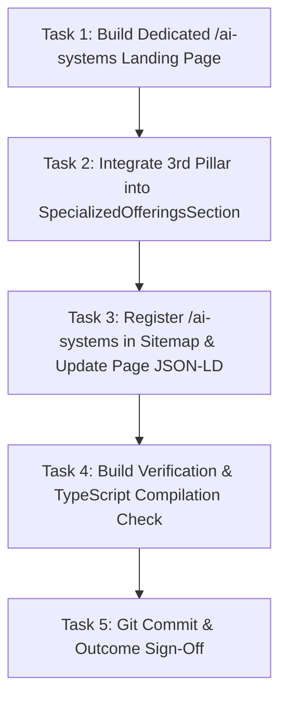

# Plan: Enterprise AI Offerings Integration (Option A)

## Description
Implement the 3rd Pillar ("Enterprise AI Architecture & Agentic Systems") in the homepage Specialized Engagements section, build the dedicated `/ai-systems` landing page, update sitemap routing, and expand semantic JSON-LD metadata.

## Precedence Graph

## Phased Plan

### Phase 1: Dedicated `/ai-systems` Landing Page
- Implement `frontend/app/ai-systems/page.tsx`.
- Include full metadata, Schema.org `Service` JSON-LD, Hero, Pitfalls, 4 Offerings, 3-Phase Process, and direct CTA.
- Acceptance Criteria: Page conforms to design tokens, uses Lucide icons, contains zero em dashes, and compiles cleanly.

### Phase 2: Homepage Specialized Offerings 3-Column Grid
- Update `frontend/components/home/SpecializedOfferingsSection.tsx` to display a 3-card responsive layout (`grid-cols-1 lg:grid-cols-3`).
- Add the Card for "Enterprise AI Architecture & Agentic Systems" with link to `/ai-systems`.
- Acceptance Criteria: Homepage renders 3 balanced, aligned offering cards on desktop and stacks neatly on mobile.

### Phase 3: Route Registration & Schema Update
- Add `/ai-systems` to `frontend/app/sitemap.ts` (`priority: 0.85`, `changeFrequency: weekly`).
- Add AI competencies to `knowsAbout` in `frontend/app/page.tsx` JSON-LD.
- Acceptance Criteria: Sitemap includes `/ai-systems` and structured data validates.

### Phase 4: Verification & Build Check
- Run `npm run build` inside `frontend/`.
- Verify zero TypeScript compiler errors, zero hydration mismatches, and successful static route generation.
- Acceptance Criteria: `npm run build` exits with code 0.

### Phase 5: Version Control Commit
- Create a clear git commit recording the implementation.
- Acceptance Criteria: Clean working tree on `master`.

## Cost Estimates
| Phase | Estimated Tokens | Estimated Cost (USD) |
|---|---|---|
| Phase 1: /ai-systems Page | ~3,500 | ~$0.012 |
| Phase 2: SpecializedOfferings Grid | ~1,200 | ~$0.005 |
| Phase 3: Sitemap & JSON-LD | ~800 | ~$0.003 |
| Phase 4: Build Verification | ~1,500 | ~$0.006 |
| **Total** | **~7,000** | **~$0.026** |
