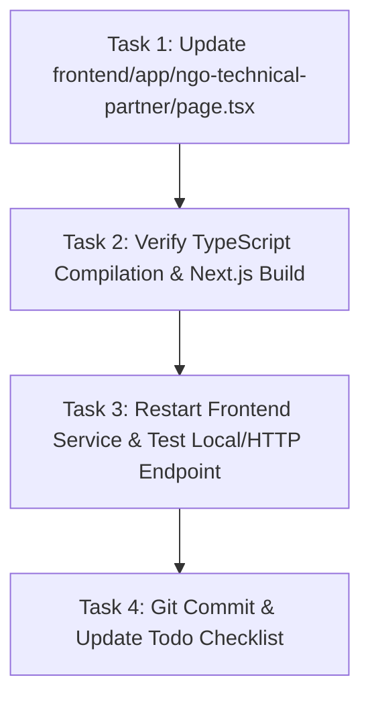

# Plan: NGO Technical Partner GDPR Compliance & AI Proposal Offerings

## Description
Update `frontend/app/ngo-technical-partner/page.tsx` to add a plain-English executive service directory for non-technical NGO visitors, a dedicated GDPR and institutional security trust section, and an AI proposal generation offering.

## Precedence Graph

## Phased Plan

### Phase 1: Update Page Component
- Edit `frontend/app/ngo-technical-partner/page.tsx`.
- Add plain-English directory section right below the hero.
- Add dedicated GDPR, security, and donor compliance trust block.
- Update pillars to include AI Proposal Generation & Workflow Automation.
- Update practical deliverables and JSON-LD metadata.
- Acceptance Criteria: Page compiles without TypeScript errors; zero em dashes.

### Phase 2: Verification & Build Validation
- Run `npx tsc --noEmit` in `frontend/`.
- Run `npm run build` in `frontend/`.
- Restart `alexseif-frontend` systemd service.
- Acceptance Criteria: Production build succeeds and HTTP 200 response verified on `/ngo-technical-partner`.

### Phase 3: Version Control Commit
- Create a focused git commit.
- Acceptance Criteria: Clean working tree on `master`.

## Cost Estimates
| Phase | Estimated Tokens | Estimated Cost (USD) |
|---|---|---|
| Phase 1: Page Implementation | ~3,500 | ~$0.012 |
| Phase 2: Build & Verification | ~1,200 | ~$0.005 |
| Phase 3: Commit & Check-off | ~500 | ~$0.002 |
| **Total** | **~5,200** | **~$0.019** |
