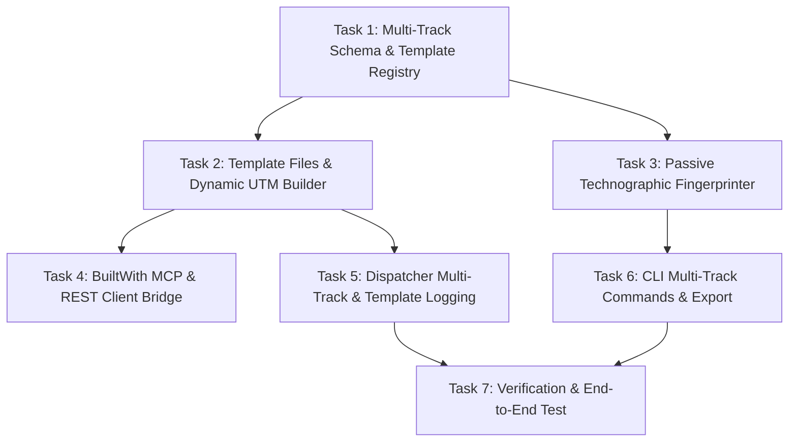

# Plan: Multi-Track Outreach Engine, Template Versioning & UTM Attribution

## Description
Implement a multi-track outreach pipeline partitioning Track 1 (Agencies) from Track 2 (Direct End-Clients). Introduces file-based and database template versioning, dynamic UTM parameter signing for analytics attribution, a zero-cost local passive technographic fingerprinter, and an automated bridge to the BuiltWith MCP server.

## Precedence Graph

## Phased Plan

### Phase 1: Data Partitioning & Template Registry
* Non-destructively migrate `targets` and `dispatch_logs` with `track`, `template_slug`, `utm_url`, and technographic fields.
* Seed `templates` table and create `outreach/templates/agency_v1.txt` and `outreach/templates/direct_client_v1.txt`.
* Implement dynamic UTM link builder in `outreach/sender.py`.
* **Acceptance Criteria:** Database migration runs smoothly on existing 22 agency records without data loss; UTM generator produces valid tracking URLs.

### Phase 2: Technographic Engine & BuiltWith Gateway
* Implement `outreach/technographics.py` with passive header and markup detection for WordPress, WooCommerce, Drupal, Magento, and PHP.
* Implement `outreach/builtwith.py` with MCP and REST endpoints, backed by SQLite caching in `builtwith_cache`.
* **Acceptance Criteria:** Live inspection test correctly identifies CMS and server headers without external API keys.

### Phase 3: Multi-Track Dispatcher & CLI Control
* Update `outreach/sender.py` to route the requested template by `template_slug` and log exact template versions and UTM URLs to `dispatch_logs`.
* Enhance `cli.py` to support `--track [agency|direct_client|all]` across `status`, `list`, `send`, and `export`.
* **Acceptance Criteria:** Dry-run preview displays hyper-personalized end-client copy with embedded UTM links and updates audit trail.

## Cost Estimates

| Phase | Estimated Tokens | Estimated Cost (USD) |
|---|---|---|
| Phase 1: Multi-Track Schema & UTM Builder | ~4,500 | ~$0.018 |
| Phase 2: Technographic & BuiltWith Gateway | ~4,000 | ~$0.016 |
| Phase 3: Multi-Track CLI & Verification | ~3,500 | ~$0.014 |
| **Total** | **~12,000** | **~$0.048** |
