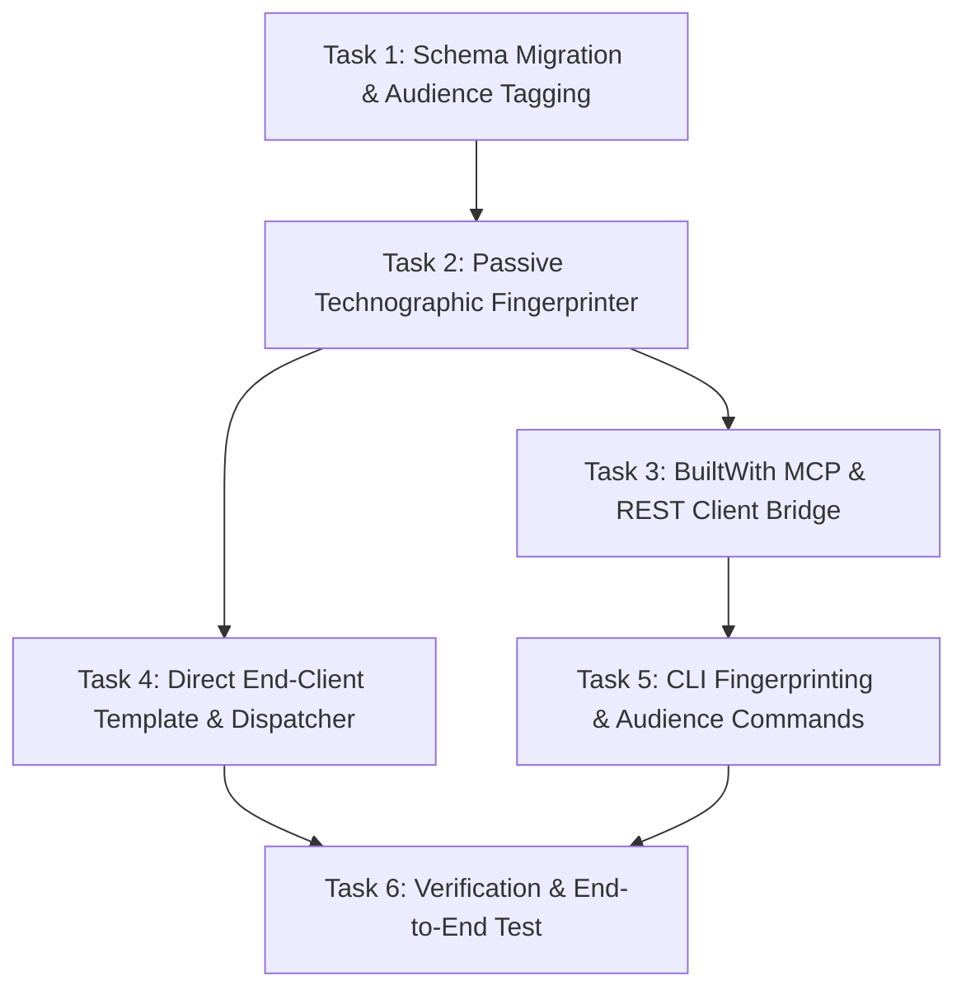

# Plan: BuiltWith MCP & Passive Technographic Direct-Client Outreach

## Description
Build the technographic lead generation and stack verification layer to target direct website owners (WordPress, Drupal, Magento, WooCommerce, PHP). Implements a zero-cost local passive stack fingerprinter with an automated bridge to the official BuiltWith MCP server (`https://api.builtwith.com/mcp`) and REST API once an API key is connected.

## Precedence Graph

## Phased Plan

### Phase 1: Database Schema & Technographic Engine
* Extend `outreach/db.py` non-destructively with `audience_type`, `detected_platform`, `detected_server`, `tech_confidence`, and `builtwith_cache` table.
* Implement `outreach/technographics.py` with passive HTTP header and HTML footprint analyzer (WordPress, WooCommerce, Drupal, Magento, Laravel, Next.js).
* **Acceptance Criteria:** `technographics.py` accurately identifies WordPress and Drupal on live domains with zero external API calls.

### Phase 2: BuiltWith MCP & API Gateway
* Implement `outreach/builtwith.py` with HTTP client for `https://api.builtwith.com/mcp` and REST lookup endpoint.
* Implement BuiltWith MCP Registry search helper for programmatic tool discovery.
* Cache all responses in SQLite to guarantee zero redundant API credit consumption.
* **Acceptance Criteria:** BuiltWith client reads credentials from `.env`, queries endpoint if key exists, caches to SQLite, or falls back seamlessly to local fingerprinter if key is missing.

### Phase 3: Direct End-Client Outreach & CLI Integration
* Add `direct_client` email template in `outreach/sender.py` focusing on business protection, customer transactions, and €140 fixed pricing.
* Add `--audience` flag to `cli.py send` (`agency` vs `direct_client`).
* Add `cli.py fingerprint` command to batch-analyze candidate websites.
* **Acceptance Criteria:** Dry-run preview displays hyper-personalized end-client copy referencing detected platform (e.g. "WordPress / WooCommerce").

## Cost Estimates

| Phase | Estimated Tokens | Estimated Cost (USD) |
|---|---|---|
| Phase 1: Schema & Passive Fingerprinter | ~4,000 | ~$0.016 |
| Phase 2: BuiltWith MCP & API Gateway | ~3,500 | ~$0.014 |
| Phase 3: Direct-Client Template & CLI | ~3,000 | ~$0.012 |
| **Total** | **~10,500** | **~$0.042** |
