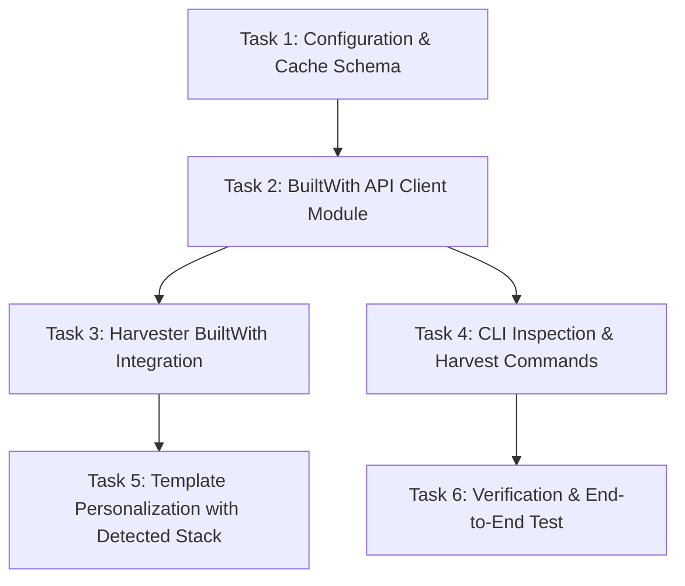

# Plan: BuiltWith API Integration for Outreach Engine

## Description
Integrate BuiltWith API capabilities into the outreach engine to programmatically verify infrastructure technologies (PHP, Node.js, Laravel, WordPress, Nginx, Apache) across target domains, harvest tech-filtered lead lists across Europe, and cache lookups in SQLite to optimize API credit usage.

## Precedence Graph

## Phased Plan

### Phase 1: Storage & API Client Foundation
* Update `outreach/config.py` and `outreach/.env.example` with `BUILTWITH_API_KEY`.
* Extend `outreach/db.py` with `builtwith_cache` table and non-destructive column additions on `targets` (`tech_stack`, `tech_verified`, `php_detected`, `nodejs_detected`).
* Implement `outreach/builtwith.py` with `lookup_domain()` and `fetch_tech_leads()`, featuring SQLite caching and error handling.
* **Acceptance Criteria:** `lookup_domain()` parses live BuiltWith payloads correctly and writes cache records to SQLite.

### Phase 2: Harvester & CLI Integration
* Extend `outreach/harvester.py` to ingest domains directly from BuiltWith technology queries.
* Add `harvest --builtwith` and `inspect <domain>` subcommands in `outreach/cli.py`.
* **Acceptance Criteria:** CLI outputs structured tech profiles for tested domains and handles missing API keys gracefully.

### Phase 3: Template Personalization & Verification
* Inject `{{DetectedStack}}` token into `outreach/sender.py` template context with sensible fallback values.
* Perform test runs with dummy domains and verified active targets.
* **Acceptance Criteria:** Dry-run displays custom stack references in email previews without breaking when stack data is unverified.

## Cost Estimates

| Phase | Estimated Tokens | Estimated Cost (USD) |
|---|---|---|
| Phase 1: Storage & API Client | ~4,500 | ~$0.018 |
| Phase 2: Harvester & CLI | ~3,500 | ~$0.014 |
| Phase 3: Personalization & Test | ~2,500 | ~$0.010 |
| **Total** | **~10,500** | **~$0.042** |
