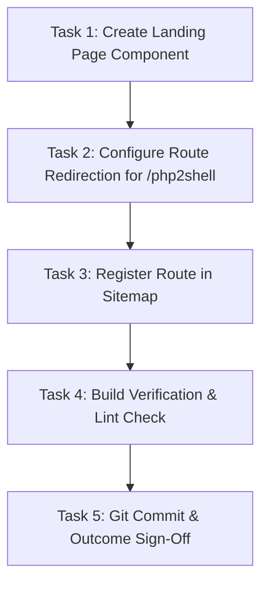

# Plan: PHP Emergency Patching & php2shell Remediation Landing Page

## Description
Implement a production-grade, SEO-optimized, and high-converting emergency landing page for PHP runtime remediation and the php2shell vulnerability on `alexseif.com`.

## Precedence Graph

## Phased Plan

### Phase 1: Core Landing Page Implementation
- Implement `frontend/app/php-emergency-patch/page.tsx`.
- Include metadata, JSON-LD (`Service`, `FAQPage`), Hero, Technical Analysis, 3-Phase Engagement, FAQ, and CTA.
- Acceptance Criteria: Page compiles without TypeScript or linter errors.

### Phase 2: Route Aliasing & Sitemap Registration
- Add redirect or rewrite in `frontend/next.config.mjs` routing `/php2shell` to `/php-emergency-patch`.
- Register `/php-emergency-patch` in `frontend/app/sitemap.ts`.
- Acceptance Criteria: Navigation to `/php2shell` resolves correctly to `/php-emergency-patch` and sitemap includes the new URL.

### Phase 3: Verification & Build Validation
- Run Next.js build test (`npm run build`) in `frontend/`.
- Verify zero TypeScript or layout breakages.
- Acceptance Criteria: `npm run build` completes with exit code 0.

## Cost Estimates
| Phase | Estimated Tokens | Estimated Cost (USD) |
|---|---|---|
| Phase 1: Implementation | ~4,000 | ~$0.015 |
| Phase 2: Route & Sitemap | ~1,000 | ~$0.004 |
| Phase 3: Verification | ~1,500 | ~$0.006 |
| **Total** | **~6,500** | **~$0.025** |
